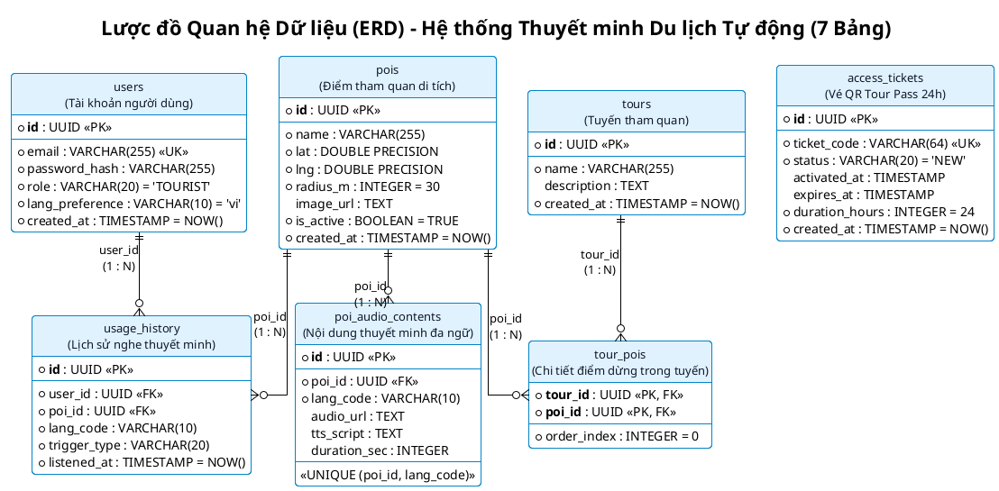

# Lược Đồ Quan Hệ Dữ Liệu (ERD - Entity Relationship Diagram)
## Dự án: Auto POI Audio Tourism Navigation System (Quận 1, TP. Hồ Chí Minh)

Lược đồ dưới đây được xây dựng chuẩn xác 100% theo **7 bảng dữ liệu** trong kịch bản khởi tạo cơ sở dữ liệu [`sql/init.sql`](file:///Users/thaonguyen/tourism_navigation_system/sql/init.sql):
1. `users`
2. `pois`
3. `poi_audio_contents`
4. `usage_history`
5. `access_tickets`
6. `tours`
7. `tour_pois`

---

## 1. Biểu diễn Lược đồ Quan hệ Dữ liệu Chuẩn (Relational Schema Notation)

Quy ước ký hiệu chuẩn trong thiết kế Cơ sở dữ liệu:
* **<u>Gạch chân đậm</u>**: Khóa chính (`Primary Key - PK`).
* *#In nghiêng có dấu thăng*: Khóa ngoại (`Foreign Key - FK`).
* **<u>*#Vừa gạch chân vừa in nghiêng*</u>**: Thuộc tính vừa tham gia làm Khóa chính kép, vừa là Khóa ngoại (`PK, FK`).

### Danh sách 7 Quan hệ (7 Bảng trong `sql/init.sql`):

1. **USERS** ( **<u>id</u>**, email, password_hash, role, lang_preference, created_at )
2. **POIS** ( **<u>id</u>**, name, lat, lng, radius_m, image_url, is_active, created_at )
3. **POI_AUDIO_CONTENTS** ( **<u>id</u>**, *#poi_id*, lang_code, audio_url, tts_script, duration_sec )
4. **USAGE_HISTORY** ( **<u>id</u>**, *#user_id*, *#poi_id*, lang_code, trigger_type, listened_at )
5. **ACCESS_TICKETS** ( **<u>id</u>**, ticket_code, status, activated_at, expires_at, duration_hours, created_at )
6. **TOURS** ( **<u>id</u>**, name, description, created_at )
7. **TOUR_POIS** ( **<u>*#tour_id*</u>**, **<u>*#poi_id*</u>**, order_index )

### Các Dây Tham chiếu Khóa ngoại (Referential Integrity Constraints):
* `POI_AUDIO_CONTENTS.#poi_id` $\longrightarrow$ `POIS.id` *(ON DELETE CASCADE)*
* `USAGE_HISTORY.#user_id` $\longrightarrow$ `USERS.id` *(ON DELETE CASCADE)*
* `USAGE_HISTORY.#poi_id` $\longrightarrow$ `POIS.id` *(ON DELETE CASCADE)*
* `TOUR_POIS.#tour_id` $\longrightarrow$ `TOURS.id` *(ON DELETE CASCADE)*
* `TOUR_POIS.#poi_id` $\longrightarrow$ `POIS.id` *(ON DELETE CASCADE)*

---

## 2. Mã PlantUML Lược đồ Quan hệ Dữ liệu (7 Bảng)

---

## 2. Sơ đồ ERD 7 Bảng (Mermaid `erDiagram`)

```mermaid
erDiagram
    USERS ||--o{ USAGE_HISTORY : "nghe thuyết minh (1-N)"
    POIS ||--o{ POI_AUDIO_CONTENTS : "có nội dung đa ngữ (1-N)"
    POIS ||--o{ USAGE_HISTORY : "được ghi nhận lượt nghe (1-N)"
    POIS ||--o{ TOUR_POIS : "thuộc lộ trình (1-N)"
    TOURS ||--o{ TOUR_POIS : "bao gồm các điểm dừng (1-N)"

    USERS {
        UUID id PK "DEFAULT gen_random_uuid()"
        VARCHAR(255) email UK "NOT NULL, Email đăng nhập"
        VARCHAR(255) password_hash "NOT NULL, Mật khẩu mã hóa Bcrypt"
        VARCHAR(20) role "NOT NULL, DEFAULT 'TOURIST' ('TOURIST' | 'ADMIN')"
        VARCHAR(10) lang_preference "NOT NULL, DEFAULT 'vi'"
        TIMESTAMP created_at "NOT NULL, DEFAULT NOW()"
    }

    POIS {
        UUID id PK "DEFAULT gen_random_uuid()"
        VARCHAR(255) name "NOT NULL, Tên điểm tham quan"
        DOUBLE_PRECISION lat "NOT NULL, Vĩ độ GPS (VD: 10.77692)"
        DOUBLE_PRECISION lng "NOT NULL, Kinh độ GPS (VD: 106.69531)"
        INTEGER radius_m "NOT NULL, DEFAULT 30 (Bán kính Geofence)"
        TEXT image_url "URL ảnh đại diện trên MinIO"
        BOOLEAN is_active "NOT NULL, DEFAULT TRUE (Hiển thị/Ẩn trên map)"
        TIMESTAMP created_at "NOT NULL, DEFAULT NOW()"
    }

    POI_AUDIO_CONTENTS {
        UUID id PK "DEFAULT gen_random_uuid()"
        UUID poi_id FK "NOT NULL, REFERENCES pois(id) ON DELETE CASCADE"
        VARCHAR(10) lang_code "NOT NULL, Mã ngôn ngữ ISO ('vi', 'en', 'zh', 'fr'...)"
        TEXT audio_url "URL file .mp3 trên MinIO"
        TEXT tts_script "Kịch bản văn bản phát giọng nói TTS"
        INTEGER duration_sec "Thời lượng audio (giây)"
    }

    USAGE_HISTORY {
        UUID id PK "DEFAULT gen_random_uuid()"
        UUID user_id FK "NOT NULL, REFERENCES users(id) ON DELETE CASCADE"
        UUID poi_id FK "NOT NULL, REFERENCES pois(id) ON DELETE CASCADE"
        VARCHAR(10) lang_code "NOT NULL, Ngôn ngữ đã nghe"
        VARCHAR(20) trigger_type "NOT NULL, 'GPS_GEOFENCE' | 'QR_CODE' | 'MANUAL'"
        TIMESTAMP listened_at "NOT NULL, DEFAULT NOW()"
    }

    ACCESS_TICKETS {
        UUID id PK "DEFAULT gen_random_uuid()"
        VARCHAR(64) ticket_code UK "NOT NULL, Mã token in trong QR (VD: TOUR-PASS-DEMO-24H)"
        VARCHAR(20) status "NOT NULL, DEFAULT 'NEW' ('NEW' | 'ACTIVE' | 'EXPIRED')"
        TIMESTAMP activated_at "Thời điểm quét mã lần đầu tiên"
        TIMESTAMP expires_at "Thời điểm hết hạn (activated_at + 24 giờ)"
        INTEGER duration_hours "NOT NULL, DEFAULT 24"
        TIMESTAMP created_at "NOT NULL, DEFAULT NOW()"
    }

    TOURS {
        UUID id PK "DEFAULT gen_random_uuid()"
        VARCHAR(255) name "NOT NULL, Tên tuyến tham quan (VD: Tour Quận 1)"
        TEXT description "Mô tả tuyến tham quan"
        TIMESTAMP created_at "NOT NULL, DEFAULT NOW()"
    }

    TOUR_POIS {
        UUID tour_id PK,FK "NOT NULL, REFERENCES tours(id) ON DELETE CASCADE"
        UUID poi_id PK,FK "NOT NULL, REFERENCES pois(id) ON DELETE CASCADE"
        INTEGER order_index "NOT NULL, DEFAULT 0 (Thứ tự trong tuyến: 1, 2, 3...)"
    }
```

---

## 2. Giải thích mối quan hệ giữa 7 bảng

| STT | Mối quan hệ | Bản số | Khóa ngoại (Foreign Key) | Ý nghĩa nghiệp vụ & Ràng buộc toàn vẹn |
| :-: | :--- | :---: | :--- | :--- |
| 1 | **`pois` — `poi_audio_contents`** | **1 : N** | `poi_audio_contents.poi_id` $\rightarrow$ `pois.id` | 1 điểm tham quan (`pois`) có nhiều nội dung thuyết minh theo từng ngôn ngữ (`vi`, `en`, `zh`, `fr`...). Ràng buộc `UNIQUE (poi_id, lang_code)` đảm bảo mỗi POI chỉ có 1 bản thuyết minh cho mỗi ngôn ngữ. `ON DELETE CASCADE`. |
| 2 | **`users` — `usage_history`** | **1 : N** | `usage_history.user_id` $\rightarrow$ `users.id` | 1 du khách (`users`) có nhiều lịch sử nghe thuyết minh (`usage_history`). Hỗ trợ truy vấn nhanh qua index `idx_usage_history_user_id (user_id, listened_at DESC)`. `ON DELETE CASCADE`. |
| 3 | **`pois` — `usage_history`** | **1 : N** | `usage_history.poi_id` $\rightarrow$ `pois.id` | 1 điểm tham quan (`pois`) được ghi nhận nhiều lượt nghe từ du khách (qua 3 cách: `GPS_GEOFENCE`, `QR_CODE`, `MANUAL`). Hỗ trợ thống kê qua index `idx_usage_history_poi_id (poi_id)`. `ON DELETE CASCADE`. |
| 4 | **`tours` — `tour_pois`** | **1 : N** | `tour_pois.tour_id` $\rightarrow$ `tours.id` | 1 tuyến tham quan (`tours`) bao gồm nhiều điểm dừng trong bảng liên kết `tour_pois`, sắp xếp theo thứ tự `order_index`. `ON DELETE CASCADE`. |
| 5 | **`pois` — `tour_pois`** | **1 : N** | `tour_pois.poi_id` $\rightarrow$ `pois.id` | 1 điểm tham quan (`pois`) có thể nằm trong một hoặc nhiều tuyến tham quan khác nhau thông qua bảng trung gian `tour_pois` (khóa chính kép `PRIMARY KEY (tour_id, poi_id)`). `ON DELETE CASCADE`. |
| 6 | **`access_tickets`** | **Độc lập** | `ticket_code` (`UNIQUE`) | Bảng độc lập quản lý mã QR vé truy cập nhanh 24h cho du khách (thay thế đăng nhập mật khẩu trên mobile: quét QR $\rightarrow$ kích hoạt phiên sử dụng 24h). |

---

## 3. Đặc tả chi tiết 7 bảng dữ liệu trong `sql/init.sql`

### Bảng 1: `users` — Tài khoản du khách và quản trị viên ([`init.sql#L13-L26`](file:///Users/thaonguyen/tourism_navigation_system/sql/init.sql#L13-L26))
| Tên cột | Kiểu dữ liệu | Ràng buộc | Mô tả |
| :--- | :--- | :--- | :--- |
| `id` | `UUID` | `PRIMARY KEY`, `DEFAULT gen_random_uuid()` | Định danh duy nhất của người dùng |
| `email` | `VARCHAR(255)` | `UNIQUE`, `NOT NULL` | Địa chỉ email đăng nhập |
| `password_hash` | `VARCHAR(255)` | `NOT NULL` | Mật khẩu đã mã hóa Bcrypt |
| `role` | `VARCHAR(20)` | `NOT NULL`, `DEFAULT 'TOURIST'` | `'TOURIST'` (du khách) hoặc `'ADMIN'` (quản trị viên CMS) |
| `lang_preference` | `VARCHAR(10)` | `NOT NULL`, `DEFAULT 'vi'` | Ngôn ngữ ưa thích (`'vi'`, `'en'`, `'zh'`, `'fr'`, `'ja'`, `'ko'`...) |
| `created_at` | `TIMESTAMP` | `NOT NULL`, `DEFAULT NOW()` | Thời điểm tạo tài khoản |

### Bảng 2: `pois` — Điểm tham quan di tích ([`init.sql#L32-L46`](file:///Users/thaonguyen/tourism_navigation_system/sql/init.sql#L32-L46))
| Tên cột | Kiểu dữ liệu | Ràng buộc | Mô tả |
| :--- | :--- | :--- | :--- |
| `id` | `UUID` | `PRIMARY KEY`, `DEFAULT gen_random_uuid()` | Định danh duy nhất của POI |
| `name` | `VARCHAR(255)` | `NOT NULL` | Tên địa danh (VD: *Dinh Độc Lập*, *Nhà Thờ Đức Bà*...) |
| `lat` | `DOUBLE PRECISION` | `NOT NULL` | Vĩ độ GPS (latitude) |
| `lng` | `DOUBLE PRECISION` | `NOT NULL` | Kinh độ GPS (longitude) |
| `radius_m` | `INTEGER` | `NOT NULL`, `DEFAULT 30` | Bán kính vùng Geofence (mét) — vào vùng tự phát thuyết minh |
| `image_url` | `TEXT` | `NULLABLE` | URL ảnh đại diện điểm tham quan |
| `is_active` | `BOOLEAN` | `NOT NULL`, `DEFAULT TRUE` | `TRUE` = hiển thị trên bản đồ, `FALSE` = ẩn |
| `created_at` | `TIMESTAMP` | `NOT NULL`, `DEFAULT NOW()` | Thời điểm tạo POI |

### Bảng 3: `poi_audio_contents` — Nội dung thuyết minh đa ngôn ngữ ([`init.sql#L53-L68`](file:///Users/thaonguyen/tourism_navigation_system/sql/init.sql#L53-L68))
| Tên cột | Kiểu dữ liệu | Ràng buộc | Mô tả |
| :--- | :--- | :--- | :--- |
| `id` | `UUID` | `PRIMARY KEY`, `DEFAULT gen_random_uuid()` | Định danh bản ghi âm thanh |
| `poi_id` | `UUID` | `NOT NULL`, `REFERENCES pois(id) ON DELETE CASCADE` | Khóa ngoại trỏ tới điểm POI |
| `lang_code` | `VARCHAR(10)` | `NOT NULL`, `UNIQUE (poi_id, lang_code)` | Mã ngôn ngữ chuẩn ISO 639-1 (`'vi'`, `'en'`, `'zh'`, `'fr'`...) |
| `audio_url` | `TEXT` | `NULLABLE` | Đường dẫn file `.mp3` trên MinIO |
| `tts_script` | `TEXT` | `NULLABLE` | Kịch bản văn bản phục vụ đọc TTS |
| `duration_sec` | `INTEGER` | `NULLABLE` | Thời lượng phát âm thanh (giây) |

### Bảng 4: `usage_history` — Lịch sử nghe của du khách ([`init.sql#L75-L95`](file:///Users/thaonguyen/tourism_navigation_system/sql/init.sql#L75-L95))
| Tên cột | Kiểu dữ liệu | Ràng buộc | Mô tả |
| :--- | :--- | :--- | :--- |
| `id` | `UUID` | `PRIMARY KEY`, `DEFAULT gen_random_uuid()` | Định danh lượt nghe |
| `user_id` | `UUID` | `NOT NULL`, `REFERENCES users(id) ON DELETE CASCADE` | Khóa ngoại trỏ tới du khách |
| `poi_id` | `UUID` | `NOT NULL`, `REFERENCES pois(id) ON DELETE CASCADE` | Khóa ngoại trỏ tới điểm POI |
| `lang_code` | `VARCHAR(10)` | `NOT NULL` | Ngôn ngữ đã nghe |
| `trigger_type` | `VARCHAR(20)` | `NOT NULL` | Cách kích hoạt: `'GPS_GEOFENCE'`, `'QR_CODE'`, `'MANUAL'` |
| `listened_at` | `TIMESTAMP` | `NOT NULL`, `DEFAULT NOW()` | Thời điểm nghe |

### Bảng 5: `access_tickets` — Mã QR vé truy cập 24h ([`init.sql#L101-L113`](file:///Users/thaonguyen/tourism_navigation_system/sql/init.sql#L101-L113))
| Tên cột | Kiểu dữ liệu | Ràng buộc | Mô tả |
| :--- | :--- | :--- | :--- |
| `id` | `UUID` | `PRIMARY KEY`, `DEFAULT gen_random_uuid()` | Định danh vé |
| `ticket_code` | `VARCHAR(64)` | `UNIQUE`, `NOT NULL` | Mã token in trong QR của vé tham quan |
| `status` | `VARCHAR(20)` | `NOT NULL`, `DEFAULT 'NEW'` | `'NEW'` (chưa quét) \| `'ACTIVE'` (đang dùng) \| `'EXPIRED'` (hết hạn) |
| `activated_at` | `TIMESTAMP` | `NULLABLE` | Thời điểm du khách quét mã lần đầu tiên |
| `expires_at` | `TIMESTAMP` | `NULLABLE` | Thời điểm hết hạn (`activated_at + 24 giờ`) |
| `duration_hours` | `INTEGER` | `NOT NULL`, `DEFAULT 24` | Thời hạn hiệu lực của vé (giờ) |
| `created_at` | `TIMESTAMP` | `NOT NULL`, `DEFAULT NOW()` | Thời điểm tạo vé |

### Bảng 6: `tours` — Tuyến tham quan ([`init.sql#L118-L124`](file:///Users/thaonguyen/tourism_navigation_system/sql/init.sql#L118-L124))
| Tên cột | Kiểu dữ liệu | Ràng buộc | Mô tả |
| :--- | :--- | :--- | :--- |
| `id` | `UUID` | `PRIMARY KEY`, `DEFAULT gen_random_uuid()` | Định danh tuyến tham quan |
| `name` | `VARCHAR(255)` | `NOT NULL` | Tên tuyến (VD: *"Tour Quận 1"*, *"Tour Di Tích Lịch Sử TP.HCM"*) |
| `description` | `TEXT` | `NULLABLE` | Mô tả chi tiết lộ trình |
| `created_at` | `TIMESTAMP` | `NOT NULL`, `DEFAULT NOW()` | Thời điểm tạo tuyến |

### Bảng 7: `tour_pois` — Danh sách POI thuộc tuyến ([`init.sql#L129-L135`](file:///Users/thaonguyen/tourism_navigation_system/sql/init.sql#L129-L135))
| Tên cột | Kiểu dữ liệu | Ràng buộc | Mô tả |
| :--- | :--- | :--- | :--- |
| `tour_id` | `UUID` | `PRIMARY KEY`, `REFERENCES tours(id) ON DELETE CASCADE` | Khóa ngoại trỏ tới bảng `tours` |
| `poi_id` | `UUID` | `PRIMARY KEY`, `REFERENCES pois(id) ON DELETE CASCADE` | Khóa ngoại trỏ tới bảng `pois` |
| `order_index` | `INTEGER` | `NOT NULL`, `DEFAULT 0` | Thứ tự điểm dừng trong tuyến (`1, 2, 3...`) |
