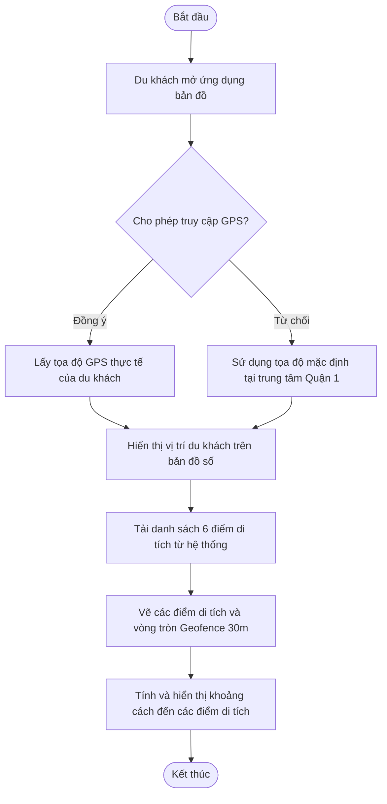
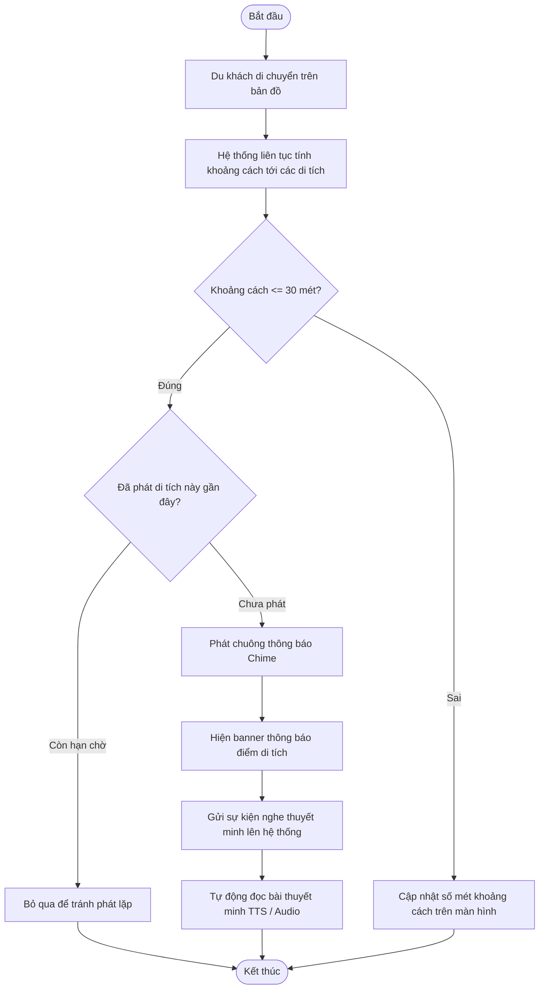
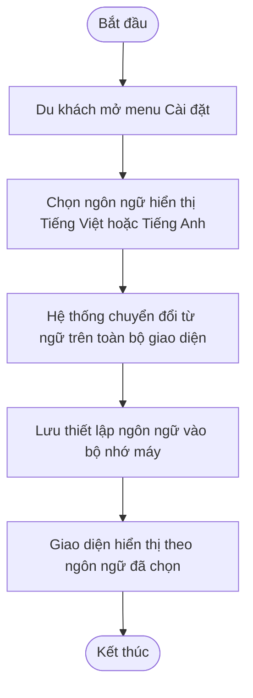
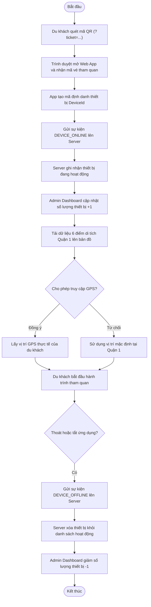
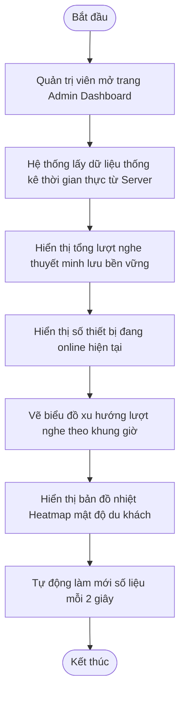
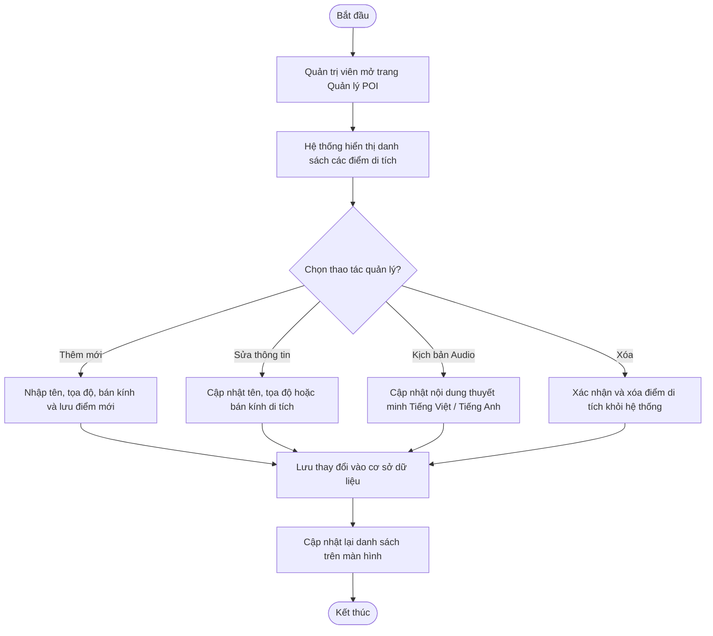
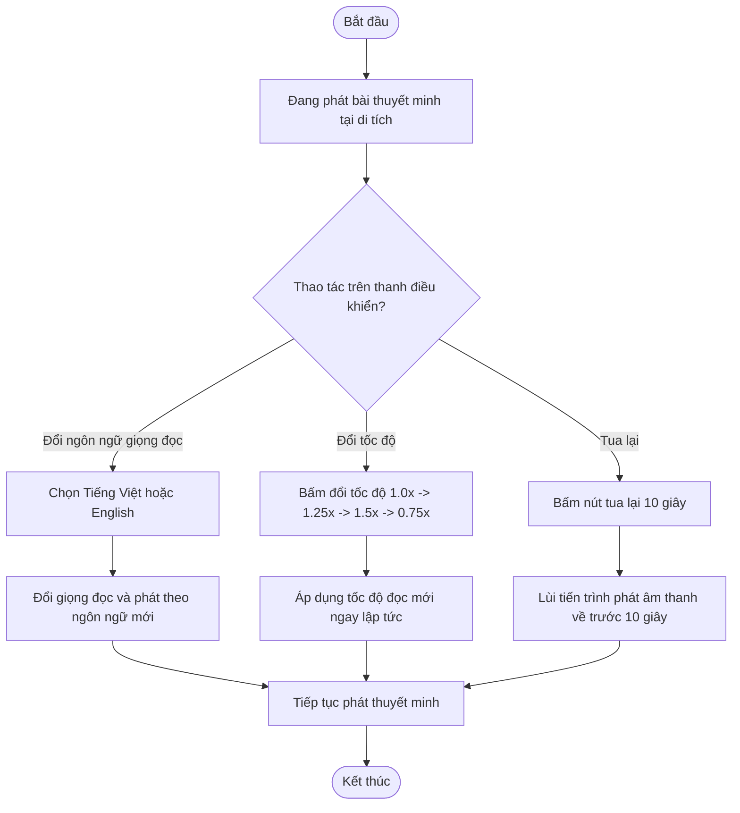
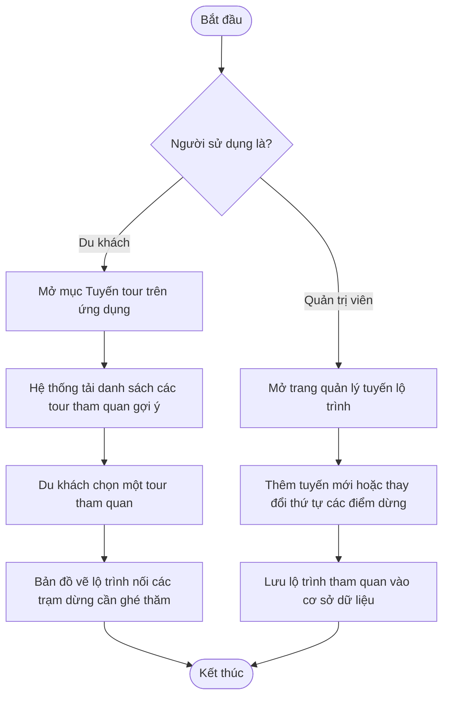

# 📖 Bảng Ánh Xạ Chi Tiết 8 Lược Đồ Hoạt Động (Activity Diagrams) Tới Từng Dòng Code

Tài liệu này ánh xạ **toàn bộ 8 Use Cases (UC01 – UC08)** theo các **Lược đồ Hoạt động (Activity Diagrams) tinh gọn** trực tiếp tới từng **file, hàm và dòng code chính xác** trong dự án. Bạn có thể bấm vào liên kết để xem ngay mã nguồn tương ứng.

---

## 📌 MỤC LỤC
1. [UC01: Định vị GPS & Bản đồ số](#-uc01-định-vị-gps--bản-đồ-số)
2. [UC02: Tự động phát thuyết minh theo Geofencing (30m)](#-uc02-tự-động-phát-thuyết-minh-theo-geofencing-30m)
3. [UC03: Tùy chọn ngôn ngữ hiển thị giao diện](#-uc03-tùy-chọn-ngôn-ngữ-hiển-thị-giao-diện)
4. [UC04: Quét QR vé truy cập vào App](#-uc04-quét-qr-vé-truy-cập-vào-app)
5. [UC05: Bảng điều khiển Quản trị Dashboard](#-uc05-bảng-điều-khiển-quản-trị-dashboard)
6. [UC06: Quản lý danh mục điểm tham quan (POI CMS)](#-uc06-quản-lý-danh-mục-điểm-tham-quan-poi-cms)
7. [UC07: Tùy chọn Audio thuyết minh & Tốc độ phát](#-uc07-tùy-chọn-audio-thuyết-minh--tốc-độ-phát)
8. [UC08: Quản lý Tuyến đường & Lộ trình tham quan](#-uc08-quản-lý-tuyến-đường--lộ-trình-tham-quan)

---

## 🔹 UC01: Định vị GPS & Bản đồ số

### 1. Lược đồ hoạt động rút gọn:

### 2. Bảng ánh xạ từng bước tới dòng code:

| Bước trong Lược đồ | File mã nguồn | Dòng code | Tên hàm / Thành phần | Giải thích kỹ thuật |
| :--- | :--- | :--- | :--- | :--- |
| **1. Mở ứng dụng & Khung bản đồ** | [client-web/index.html](file:///C:/Users/huykh/tourism_navigation_system/client-web/index.html#L52-L74) | `52 - 74` | `
` | Khung chứa bản đồ Leaflet trên Web di động |
| **2. Khởi tạo bản đồ Leaflet** | [client-web/app.js](file:///C:/Users/huykh/tourism_navigation_system/client-web/app.js#L203-L239) | `203 - 239` | [`initMap()`](file:///C:/Users/huykh/tourism_navigation_system/client-web/app.js#L203-L239) | Nạp lớp bản đồ đường phố Google Maps Tile Layer |
| **3A. Cấp quyền GPS thật** | [client-web/app.js](file:///C:/Users/huykh/tourism_navigation_system/client-web/app.js#L714-L732) | `714 - 732` | `navigator.geolocation` | Lấy tọa độ GPS thực tế của điện thoại du khách |
| **3B. Từ chối / Tọa độ mặc định** | [client-web/app.js](file:///C:/Users/huykh/tourism_navigation_system/client-web/app.js#L88-L91) | `88 - 91` | `state.currentLat`, `currentLng` | Gán tọa độ trung tâm Quận 1: `(10.77450, 106.69420)` |
| **4. Hiển thị Marker du khách** | [client-web/app.js](file:///C:/Users/huykh/tourism_navigation_system/client-web/app.js#L230-L239) | `230 - 239` | `state.userMarker` | Vẽ icon người đi bộ màu xanh biển lên bản đồ |
| **5. Gọi API lấy danh sách di tích** | [client-web/app.js](file:///C:/Users/huykh/tourism_navigation_system/client-web/app.js#L288-L293) | `288 - 293` | [`fetchPois()`](file:///C:/Users/huykh/tourism_navigation_system/client-web/app.js#L288-L293) | Gọi `GET /api/v1/pois?lat=...&lng=...&radius=3000` |
| **6. Backend truy vấn CSDL & Cache** | [PoiRepository.java](file:///C:/Users/huykh/tourism_navigation_system/backend/poi-service/src/main/java/com/poitour/poi/repository/PoiRepository.java#L21-L39)   [PoiService.java](file:///C:/Users/huykh/tourism_navigation_system/backend/poi-service/src/main/java/com/poitour/poi/service/PoiService.java#L38-L52) | `21 - 39`   `38 - 52` | [`findNearbyPois()`](file:///C:/Users/huykh/tourism_navigation_system/backend/poi-service/src/main/java/com/poitour/poi/repository/PoiRepository.java#L21-L39)   [`initRedisGeoCache()`](file:///C:/Users/huykh/tourism_navigation_system/backend/poi-service/src/main/java/com/poitour/poi/service/PoiService.java#L38-L52) | Công thức cầu Haversine trong SQL & Cache Redis GEO |
| **7. Vẽ POI & Vòng tròn Geofence 30m** | [client-web/app.js](file:///C:/Users/huykh/tourism_navigation_system/client-web/app.js#L241-L283) | `241 - 283` | [`renderPoiMarkers()`](file:///C:/Users/huykh/tourism_navigation_system/client-web/app.js#L241-L283) | Tạo marker màu đỏ và `L.circle` với `radius: 30m` |
| **8. Tính và cập nhật khoảng cách** | [client-web/app.js](file:///C:/Users/huykh/tourism_navigation_system/client-web/app.js#L337-L365) | `337 - 365` | [`updateDistancesAndZone()`](file:///C:/Users/huykh/tourism_navigation_system/client-web/app.js#L337-L365) | Cập nhật số mét khoảng cách tới từng điểm trên giao diện |

---

## 🔹 UC02: Tự động phát thuyết minh theo Geofencing (30m)

### 1. Lược đồ hoạt động rút gọn:

### 2. Bảng ánh xạ từng bước tới dòng code:

| Bước trong Lược đồ | File mã nguồn | Dòng code | Tên hàm / Thành phần | Giải thích kỹ thuật |
| :--- | :--- | :--- | :--- | :--- |
| **1. Cập nhật vị trí khi di chuyển** | [client-web/app.js](file:///C:/Users/huykh/tourism_navigation_system/client-web/app.js#L326-L335) | `326 - 335` | [`updateUserPosition()`](file:///C:/Users/huykh/tourism_navigation_system/client-web/app.js#L326-L335) | Cập nhật tọa độ Marker người dùng trên Leaflet |
| **2. Tính khoảng cách Haversine** | [client-web/app.js](file:///C:/Users/huykh/tourism_navigation_system/client-web/app.js#L367-L375) | `367 - 375` | [`calculateHaversine()`](file:///C:/Users/huykh/tourism_navigation_system/client-web/app.js#L367-L375) | Tính khoảng cách đường đại vòng giữa 2 tọa độ (mét) |
| **3. Kiểm tra điều kiện vào vùng 30m** | [client-web/app.js](file:///C:/Users/huykh/tourism_navigation_system/client-web/app.js#L347-L351) | `347 - 351` | `isInside = dist <= 30` | So sánh khoảng cách với bán kính kích hoạt của di tích |
| **4. Kiểm tra Cooldown chống lặp** | [client-web/app.js](file:///C:/Users/huykh/tourism_navigation_system/client-web/app.js#L353-L360) | `353 - 360` | `GEOFENCE_COOLDOWN_MS` | Tránh đọc lặp lại cùng một di tích khi du khách đứng yên |
| **5. Phát chuông thông báo (Chime)** | [client-web/app.js](file:///C:/Users/huykh/tourism_navigation_system/client-web/app.js#L178-L198) | `178 - 198` | [`playNotificationChime()`](file:///C:/Users/huykh/tourism_navigation_system/client-web/app.js#L178-L198) | Dùng Web Audio API phát 2 nốt nhạc chuông nhẹ (880Hz -> 1320Hz) |
| **6. Hiển thị Banner di tích** | [client-web/app.js](file:///C:/Users/huykh/tourism_navigation_system/client-web/app.js#L342-L345) | `342 - 345` | `dom.zoneStatus` | Hiển thị thanh trạng thái màu xanh lá: "Đang ở trong vùng di tích" |
| **7. Gửi sự kiện POI_PLAY lên Server** | [client-web/app.js](file:///C:/Users/huykh/tourism_navigation_system/client-web/app.js#L481-L496) | `481 - 496` | [`notifyPoiPlay()`](file:///C:/Users/huykh/tourism_navigation_system/client-web/app.js#L481-L496) | Gửi `POST /api/event` để Server cộng dồn tổng lượt nghe |
| **8. Tự động đọc bài thuyết minh (TTS)** | [client-web/app.js](file:///C:/Users/huykh/tourism_navigation_system/client-web/app.js#L530-L578) | `530 - 578` | [`playViaTTS()`](file:///C:/Users/huykh/tourism_navigation_system/client-web/app.js#L530-L578) | Kích hoạt `window.speechSynthesis` đọc nội dung kịch bản |

---

## 🔹 UC03: Tùy chọn ngôn ngữ hiển thị giao diện

### 1. Lược đồ hoạt động rút gọn:

### 2. Bảng ánh xạ từng bước tới dòng code:

| Bước trong Lược đồ | File mã nguồn | Dòng code | Tên hàm / Thành phần | Giải thích kỹ thuật |
| :--- | :--- | :--- | :--- | :--- |
| **1. Menu cài đặt ngôn ngữ** | [client-web/index.html](file:///C:/Users/huykh/tourism_navigation_system/client-web/index.html#L256-L267) | `256 - 267` | `<select id="settingLang">` | Hộp chọn ngôn ngữ: Tiếng Việt (`vi`) / English (`en`) |
| **2. Bắt sự kiện đổi ngôn ngữ** | [client-web/app.js](file:///C:/Users/huykh/tourism_navigation_system/client-web/app.js#L691-L695) | `691 - 695` | `settingLang.addEventListener` | Lắng nghe khi du khách chọn ngôn ngữ khác |
| **3. Cập nhật các chuỗi giao diện** | [client-web/app.js](file:///C:/Users/huykh/tourism_navigation_system/client-web/app.js#L295-L318) | `295 - 318` | `state.currentLang` | Thay đổi nhãn hiển thị, tiêu đề và tải lại danh sách POI tương ứng |
| **4. Lưu thiết lập vào localStorage** | [client-web/app.js](file:///C:/Users/huykh/tourism_navigation_system/client-web/app.js#L693) | `693` | `localStorage.setItem('lang')` | Giúp ứng dụng ghi nhớ ngôn ngữ cho các lần truy cập sau |

---

## 🔹 UC04: Quét QR vé truy cập vào App

### 1. Lược đồ hoạt động rút gọn:

### 2. Bảng ánh xạ từng bước tới dòng code:

| Bước trong Lược đồ | File mã nguồn | Dòng code | Tên hàm / Thành phần | Giải thích kỹ thuật |
| :--- | :--- | :--- | :--- | :--- |
| **1. Quét QR & Kiểm tra vé** | [init.sql](file:///C:/Users/huykh/tourism_navigation_system/sql/init.sql#L70-L95) | `70 - 95` | `CREATE TABLE tickets` | Mã vé `TOUR-PASS-DEMO-24H` có hiệu lực tham quan trong 24 giờ |
| **2. Tiếp nhận URL & Trả về App** | [server.js](file:///C:/Users/huykh/tourism_navigation_system/client-web/server.js#L87-L88)   [server.js](file:///C:/Users/huykh/tourism_navigation_system/client-web/server.js#L187-L210) | `87 - 88`   `187 - 210` | `req.url.split('?')[0]`   `fs.readFile` | Bóc tách tham số vé và nạp trang web di động `index.html` |
| **3. Sinh Device ID bền vững** | [client-web/app.js](file:///C:/Users/huykh/tourism_navigation_system/client-web/app.js#L423-L438) | `423 - 438` | [`getOrCreateDeviceId()`](file:///C:/Users/huykh/tourism_navigation_system/client-web/app.js#L423-L438) | Lưu vào localStorage, chống bị cộng dồn số lượng thiết bị |
| **4. Gửi `DEVICE_ONLINE`** | [client-web/app.js](file:///C:/Users/huykh/tourism_navigation_system/client-web/app.js#L440-L448) | `440 - 448` | [`sendRealtimeHeartbeat()`](file:///C:/Users/huykh/tourism_navigation_system/client-web/app.js#L440-L448) | Gửi `POST /api/event` kèm mã máy định kỳ 3 giây |
| **5. Server lưu `activeDevices`** | [server.js](file:///C:/Users/huykh/tourism_navigation_system/client-web/server.js#L90-L123) | `90 - 123` | `activeDevices.set(devId)` | Lưu danh sách các thiết bị đang online vào bộ nhớ Server |
| **6. Admin Dashboard tăng (+1)** | [admin-web/app.js](file:///C:/Users/huykh/tourism_navigation_system/admin-web/app.js#L450-L462)   [admin-web/app.js](file:///C:/Users/huykh/tourism_navigation_system/admin-web/app.js#L540-L553) | `450 - 462`   `540 - 553` | `cardActiveDevices`   [`pollRealtimeStats()`](file:///C:/Users/huykh/tourism_navigation_system/admin-web/app.js#L540-L553) | Đọc số thiết bị online từ Server và hiển thị lên thẻ thống kê |
| **7. Tải 6 POI & Vẽ bản đồ** | [client-web/app.js](file:///C:/Users/huykh/tourism_navigation_system/client-web/app.js#L288-L321) | `288 - 321` | [`fetchPois()`](file:///C:/Users/huykh/tourism_navigation_system/client-web/app.js#L288-L321) | Lấy tọa độ 6 danh thắng Quận 1 và ghim lên Leaflet |
| **8. Hỏi quyền & Lấy vị trí GPS** | [client-web/app.js](file:///C:/Users/huykh/tourism_navigation_system/client-web/app.js#L714-L732) | `714 - 732` | `navigator.geolocation` | Lấy tọa độ thực tế hoặc fallback vị trí mặc định Quận 1 |
| **9. Thoát app -> Gửi `DEVICE_OFFLINE`** | [client-web/app.js](file:///C:/Users/huykh/tourism_navigation_system/client-web/app.js#L450-L463) | `450 - 463` | [`sendDeviceOffline()`](file:///C:/Users/huykh/tourism_navigation_system/client-web/app.js#L450-L463) | Dùng `navigator.sendBeacon` báo ngay khi đóng ứng dụng |
| **10. Server xóa & Admin giảm (-1)** | [server.js](file:///C:/Users/huykh/tourism_navigation_system/client-web/server.js#L101-L108)   [admin-web/app.js](file:///C:/Users/huykh/tourism_navigation_system/admin-web/app.js#L450-L462) | `101 - 108`   `450 - 462` | `activeDevices.delete()` | Server xóa máy và Admin tự động cập nhật giảm số tức thì |

---

## 🔹 UC05: Bảng điều khiển Quản trị Dashboard

### 1. Lược đồ hoạt động rút gọn:

### 2. Bảng ánh xạ từng bước tới dòng code:

| Bước trong Lược đồ | File mã nguồn | Dòng code | Tên hàm / Thành phần | Giải thích kỹ thuật |
| :--- | :--- | :--- | :--- | :--- |
| **1. Khung giao diện Dashboard** | [admin-web/index.html](file:///C:/Users/huykh/tourism_navigation_system/admin-web/index.html#L127-L290) | `127 - 290` | `cardTotalAudience`, `cardActiveDevices` | Giao diện 4 thẻ thống kê, biểu đồ Chart.js và bản đồ nhiệt |
| **2. Lấy số liệu thời gian thực** | [server.js](file:///C:/Users/huykh/tourism_navigation_system/client-web/server.js#L140-L152)   [admin-web/app.js](file:///C:/Users/huykh/tourism_navigation_system/admin-web/app.js#L540-L604) | `140 - 152`   `540 - 604` | `GET /api/realtime-stats`   [`pollRealtimeStats()`](file:///C:/Users/huykh/tourism_navigation_system/admin-web/app.js#L540-L604) | Server tổng hợp số liệu và Admin gửi request lấy mỗi 2 giây |
| **3. Tổng lượt nghe lưu bền vững** | [server.js](file:///C:/Users/huykh/tourism_navigation_system/client-web/server.js#L20-L58) | `20 - 58` | [`loadPersistentStats()`](file:///C:/Users/huykh/tourism_navigation_system/client-web/server.js#L20-L39)   [`savePersistentStats()`](file:///C:/Users/huykh/tourism_navigation_system/client-web/server.js#L42-L58) | Đọc/Ghi dữ liệu vào [stats-data.json](file:///C:/Users/huykh/tourism_navigation_system/client-web/stats-data.json), không bị mất khi khởi động lại |
| **4. Hiển thị số thiết bị online** | [admin-web/app.js](file:///C:/Users/huykh/tourism_navigation_system/admin-web/app.js#L450-L462) | `450 - 462` | [`updateStatCards()`](file:///C:/Users/huykh/tourism_navigation_system/admin-web/app.js#L450-L462) | Hiển thị chính xác số thiết bị điện thoại đang online |
| **5. Biểu đồ xu hướng lượt nghe** | [admin-web/app.js](file:///C:/Users/huykh/tourism_navigation_system/admin-web/app.js#L168-L234) | `168 - 234` | [`initChart()`](file:///C:/Users/huykh/tourism_navigation_system/admin-web/app.js#L168-L234) | Vẽ biểu đồ đường Chart.js thể hiện lưu lượng theo từng khung giờ |
| **6. Bản đồ nhiệt Heatmap** | [admin-web/app.js](file:///C:/Users/huykh/tourism_navigation_system/admin-web/app.js#L237-L290) | `237 - 290` | [`initHeatmapMap()`](file:///C:/Users/huykh/tourism_navigation_system/admin-web/app.js#L237-L290) | Vẽ các quầng nhiệt đỏ/cam/vàng thể hiện mức độ đông đúc tại các POI |
| **7. Tự động đồng bộ mỗi 2 giây** | [admin-web/app.js](file:///C:/Users/huykh/tourism_navigation_system/admin-web/app.js#L602-L604) | `602 - 604` | `setInterval(pollRealtimeStats, 2000)` | Duy trì cập nhật dữ liệu tự động liên tục |

---

## 🔹 UC06: Quản lý danh mục điểm tham quan (POI CMS)

### 1. Lược đồ hoạt động rút gọn:

### 2. Bảng ánh xạ từng bước tới dòng code:

| Bước trong Lược đồ | File mã nguồn | Dòng code | Tên hàm / Thành phần | Giải thích kỹ thuật |
| :--- | :--- | :--- | :--- | :--- |
| **1. Bảng danh sách quản lý POI** | [admin-web/app.js](file:///C:/Users/huykh/tourism_navigation_system/admin-web/app.js#L376-L430) | `376 - 430` | [`renderPoiTable()`](file:///C:/Users/huykh/tourism_navigation_system/admin-web/app.js#L376-L430) | Kết xuất bảng danh sách 6 điểm di tích kèm biểu tượng vector |
| **2A. Thêm POI mới** | [admin-web/app.js](file:///C:/Users/huykh/tourism_navigation_system/admin-web/app.js#L627-L679)   [PoiController.java](file:///C:/Users/huykh/tourism_navigation_system/backend/poi-service/src/main/java/com/poitour/poi/controller/PoiController.java#L80-L84) | `627 - 679`   `80 - 84` | `poiForm.onsubmit`   [`createPoi()`](file:///C:/Users/huykh/tourism_navigation_system/backend/poi-service/src/main/java/com/poitour/poi/controller/PoiController.java#L80-L84) | Gửi `POST /api/v1/pois` và lưu vào PostgreSQL |
| **2B. Sửa thông tin POI** | [admin-web/app.js](file:///C:/Users/huykh/tourism_navigation_system/admin-web/app.js#L707-L721)   [PoiController.java](file:///C:/Users/huykh/tourism_navigation_system/backend/poi-service/src/main/java/com/poitour/poi/controller/PoiController.java#L90-L96) | `707 - 721`   `90 - 96` | [`openEditModal()`](file:///C:/Users/huykh/tourism_navigation_system/admin-web/app.js#L707-L721)   [`updatePoi()`](file:///C:/Users/huykh/tourism_navigation_system/backend/poi-service/src/main/java/com/poitour/poi/controller/PoiController.java#L90-L96) | Mở hộp thoại sửa và gửi `PUT /api/v1/pois/{id}` |
| **2C. Quản lý kịch bản Audio** | [admin-web/app.js](file:///C:/Users/huykh/tourism_navigation_system/admin-web/app.js#L681-L705)   [PoiController.java](file:///C:/Users/huykh/tourism_navigation_system/backend/poi-service/src/main/java/com/poitour/poi/controller/PoiController.java#L112-L118) | `681 - 705`   `112 - 118` | `audioForm.onsubmit`   [`saveAudio()`](file:///C:/Users/huykh/tourism_navigation_system/backend/poi-service/src/main/java/com/poitour/poi/controller/PoiController.java#L112-L118) | Gửi `POST /api/v1/pois/{id}/audio` lưu kịch bản đa ngữ |
| **2D. Xóa điểm di tích** | [admin-web/app.js](file:///C:/Users/huykh/tourism_navigation_system/admin-web/app.js#L728-L740)   [PoiController.java](file:///C:/Users/huykh/tourism_navigation_system/backend/poi-service/src/main/java/com/poitour/poi/controller/PoiController.java#L102-L106) | `728 - 740`   `102 - 106` | [`deletePoi()`](file:///C:/Users/huykh/tourism_navigation_system/admin-web/app.js#L728-L740) | Xác nhận xóa và gửi `DELETE /api/v1/pois/{id}` |
| **3. Cập nhật dữ liệu & Làm mới bảng** | [PoiService.java](file:///C:/Users/huykh/tourism_navigation_system/backend/poi-service/src/main/java/com/poitour/poi/service/PoiService.java#L88-L179) | `88 - 179` | `poiRepository.save()` | Lưu CSDL PostgreSQL, cập nhật Redis GEO và nạp lại bảng |

---

## 🔹 UC07: Tùy chọn Audio thuyết minh & Tốc độ phát

### 1. Lược đồ hoạt động rút gọn:

### 2. Bảng ánh xạ từng bước tới dòng code:

| Bước trong Lược đồ | File mã nguồn | Dòng code | Tên hàm / Thành phần | Giải thích kỹ thuật |
| :--- | :--- | :--- | :--- | :--- |
| **1. Khung điều khiển Audio Player** | [client-web/index.html](file:///C:/Users/huykh/tourism_navigation_system/client-web/index.html#L112-L155) | `112 - 155` | `#audioSheet` | Thanh phát âm thanh nổi: Nút Play, Tua lùi, Chỉnh tốc độ |
| **2. Đổi ngôn ngữ giọng đọc TTS** | [client-web/app.js](file:///C:/Users/huykh/tourism_navigation_system/client-web/app.js#L540-L555) | `540 - 555` | `utterance.lang` | Chuyển giữa giọng đọc tiếng Việt (`vi-VN`) và tiếng Anh (`en-US`) |
| **3. Chuyển đổi tốc độ phát** | [client-web/app.js](file:///C:/Users/huykh/tourism_navigation_system/client-web/app.js#L599-L609) | `599 - 609` | [`cycleSpeed()`](file:///C:/Users/huykh/tourism_navigation_system/client-web/app.js#L599-L609) | Vòng lặp tốc độ: `[1, 1.25, 1.5, 0.75]`, gán `utterance.rate` |
| **4. Tua lùi 10 giây** | [client-web/app.js](file:///C:/Users/huykh/tourism_navigation_system/client-web/app.js#L594-L597) | `594 - 597` | [`rewind10s()`](file:///C:/Users/huykh/tourism_navigation_system/client-web/app.js#L594-L597) | Trừ lùi mốc thời gian phát âm thanh 10 giây |

---

## 🔹 UC08: Quản lý Tuyến đường & Lộ trình tham quan

### 1. Lược đồ hoạt động rút gọn:

### 2. Bảng ánh xạ từng bước tới dòng code:

| Bước trong Lược đồ | File mã nguồn | Dòng code | Tên hàm / Thành phần | Giải thích kỹ thuật |
| :--- | :--- | :--- | :--- | :--- |
| **1. Giao diện chọn Tuyến tour trên Mobile** | [client-web/index.html](file:///C:/Users/huykh/tourism_navigation_system/client-web/index.html#L157-L238)   [client-web/app.js](file:///C:/Users/huykh/tourism_navigation_system/client-web/app.js#L672-L688) | `157 - 238`   `672 - 688` | `<section id="tabTours">`   `dom.tourCards.forEach` | Danh sách tour tham quan Quận 1 và sự kiện chọn tour |
| **2. Điều hướng qua API Gateway** | [application.yml](file:///C:/Users/huykh/tourism_navigation_system/backend/api-gateway/src/main/resources/application.yml#L40-L44) | `40 - 44` | `tracking-service-route` | Chuyển request `/api/routes/**` sang Tracking Service cổng 8083 |
| **3. API danh sách & cập nhật tuyến** | [TravelRouteController.java](file:///C:/Users/huykh/tourism_navigation_system/backend/tracking-service/src/main/java/com/tourism/tracking/controller/TravelRouteController.java#L23-L83) | `23 - 83` | [`getAllRoutes()`](file:///C:/Users/huykh/tourism_navigation_system/backend/tracking-service/src/main/java/com/tourism/tracking/controller/TravelRouteController.java#L30-L33)   [`updateRouteStops()`](file:///C:/Users/huykh/tourism_navigation_system/backend/tracking-service/src/main/java/com/tourism/tracking/controller/TravelRouteController.java#L60-L72) | Xử lý yêu cầu lấy tour và cập nhật trạm dừng từ Controller |
| **4. Xử lý nghiệp vụ lộ trình tour** | [TravelRouteService.java](file:///C:/Users/huykh/tourism_navigation_system/backend/tracking-service/src/main/java/com/tourism/tracking/service/TravelRouteService.java#L20-L72) | `20 - 72` | [`TravelRouteService`](file:///C:/Users/huykh/tourism_navigation_system/backend/tracking-service/src/main/java/com/tourism/tracking/service/TravelRouteService.java#L12-L73) | Quản lý danh sách trạm dừng theo thứ tự di chuyển |
| **5. Cấu trúc bảng CSDL tuyến lộ trình** | [TravelRoute.java](file:///C:/Users/huykh/tourism_navigation_system/backend/tracking-service/src/main/java/com/tourism/tracking/model/TravelRoute.java#L18-L40)   [init.sql](file:///C:/Users/huykh/tourism_navigation_system/sql/init.sql#L98-L140) | `18 - 40`   `98 - 140` | `travel_routes`   `travel_route_pois` | Thực thể JPA và bảng lưu thông tin tuyến tham quan |
